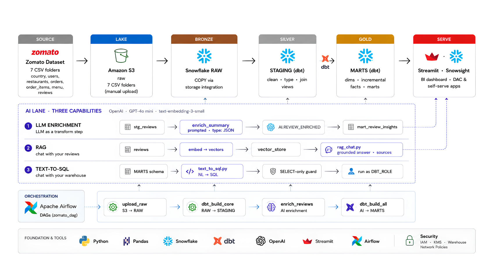

<div align="center">

# Zomato AI Analytics

**A production-shaped analytics stack on 33.6 million food-delivery orders — and an AI lane that reads, retrieves and queries them.**

S3 → Snowflake → dbt → Gemini → Streamlit, orchestrated with Airflow.

[](https://github.com/RISHII7/Zomato-AI-Analytics/actions/workflows/ci.yml)
[](https://github.com/RISHII7/Zomato-AI-Analytics/releases)
[](LICENSE)
[](https://www.snowflake.com/)
[](https://www.getdbt.com/)
[](https://airflow.apache.org/)
[](https://www.python.org/)

</div>

---



---

## What this is

A complete, opinionated data platform built on a realistic food-delivery dataset — 10 million orders, 23 million line items, 148,541 restaurants — taken from raw CSVs in an S3 bucket all the way to a warehouse a language model can answer questions against.

It is a portfolio project, but it is not a toy. The row counts are real, the cost decisions are real, and the failure modes documented here were hit and fixed rather than imagined.

**What makes it worth reading:**

- **The data fights back.** `restaurant.rating` holds the string `'--'` in 58.6% of rows. `cost` holds `'₹ 200'`. One row of 371,561 in `food.csv` is missing a field. Every loader setting in [`snowflake/`](snowflake/) exists because of a specific measured property of these files, and each is explained where it appears.
- **The AI lane is designed around the data, not bolted on.** `reviews.comment` contains only **294 distinct strings across 300,000 rows**. Enriching row-by-row would send each string to the model ~1,020 times. Enriching the distinct set costs ~0.1% of the tokens for identical output — and the vector store needs 294 vectors, not 300,000.
- **Security is the design, not a section at the end.** Snowflake never holds an AWS credential. The cross-account trust is pinned with an `sts:ExternalId` because Snowflake shares one IAM principal across customers — without it, another tenant could have Snowflake read your bucket for them.

---

## Table of contents

- [Quickstart](#quickstart)
- [The stack](#the-stack)
- [Architecture](#architecture)
- [The AI lane](#the-ai-lane)
- [The data](#the-data)
- [Three ways to get a wrong number](#three-ways-to-get-a-wrong-number)
- [Security model](#security-model)
- [Repository layout](#repository-layout)
- [Cost](#cost)
- [Project status](#project-status)
- [Documentation](#documentation)
- [Contributing](#contributing)

---

## Quickstart

```bash
git clone https://github.com/RISHII7/Zomato-AI-Analytics.git
cd Zomato-AI-Analytics

python -m venv .venv
source .venv/bin/activate          # Windows: .venv\Scripts\activate
pip install -r requirements-dev.txt

cp .env.example .env               # fill in your own values
python scripts/make_samples.py --check
```

You now have five full source tables and referentially-intact extracts of the two large ones — enough to explore the schema without touching a cloud account.

To build the warehouse for real, follow **[docs/RUNBOOK.md](docs/RUNBOOK.md)**: empty AWS account to 33.6 M loaded rows in six steps, roughly 90 minutes.

> **Note**
> `data/orders.csv` (1.33 GB) and `data/order_items.csv` (955 MB) are not in git — both exceed GitHub's 100 MB per-file limit. The lake lives in S3, which is where a lake belongs. See [the data section](#the-data).

---

## The stack

| Layer | Tool | Why this one |
| ----- | ---- | ------------ |
| Lake | **Amazon S3** | Cheap, durable, and the thing Snowflake integrates with natively via role assumption rather than keys |
| Warehouse | **Snowflake** | Separated storage and compute means a 23 M-row load can run on MEDIUM and everything after it on XSMALL |
| Transformation | **dbt** | Version-controlled SQL with tests and lineage. The tests are the point — this dataset has traps that only a test catches |
| AI | **Google Gemini** — `gemini-2.5-flash`, `gemini-embedding-001` | Cheap enough to run over a real table; capable enough for structured extraction |
| Orchestration | **Apache Airflow** | Four DAGs with real dependencies, not a cron file |
| Serving | **Streamlit** + Snowsight | One for the self-serve app, one for warehouse-native dashboards |

---

## Architecture

A medallion warehouse with an AI lane running alongside it, not bolted onto the end.

```
SOURCE          LAKE            BRONZE          SILVER          GOLD            SERVE
─────────────────────────────────────────────────────────────────────────────────────
7 CSVs     →    S3         →    RAW        →    STAGING    →    MARTS      →    Streamlit
33.6 M rows     raw/            COPY via        clean            dims             Snowsight
                7 prefixes      integration     type · join      facts
                                                (dbt)            (dbt)
                                    ↑               ↑               ↑
                                    └───────────────┴───────────────┘
                                          AI LANE (3 capabilities)
```

### The layers

| Schema | Holds | Typing |
| ------ | ----- | ------ |
| `RAW` | Landing zone, straight off the CSVs | Dimensions all-`STRING`, facts typed |
| `BRONZE` | Iceberg tables, for the Spark path | — |
| `STAGING` | Cleaned, conformed, renamed | Correct types, `TRY_CAST` |
| `MARTS` | Gold — facts and dimensions | Modelled |
| `SNAPSHOTS` | SCD2 history | — |
| `AI` | LLM-enriched tables | — |

### One principle worth stating

**A landing zone should be maximally tolerant; a transformation layer maximally strict.**

Failing at `RAW` means no data at all and nothing to inspect. Failing at `STAGING` means the bad row is sitting in a table you can query. That single idea explains most of the loader configuration:

```sql
-- Scraped dimensions: messy by nature, tolerate and skip
COPY INTO RAW.restaurants ... ON_ERROR = 'CONTINUE';

-- Generated facts: clean by nature, any error is evidence of a bug
COPY INTO RAW.orders      ... ON_ERROR = 'ABORT_STATEMENT';
```

A single global `ON_ERROR` would be wrong in one direction or the other. `CONTINUE` on the facts would let rows vanish from a table that is supposed to be exactly 10,000,000 — undetectably, since there is no second source to reconcile against.

The same reasoning sets `ERROR_ON_COLUMN_COUNT_MISMATCH = FALSE` on the file format: **one** malformed row in `food.csv` would otherwise abort a load of 371,560 good ones.

---

## The AI lane

Three capabilities, each solving a different problem.

### 1 · LLM enrichment — the model as a transform step

`stg_reviews` → prompted extraction → `AI.REVIEW_ENRICHED` → `mart_review_insights`

Structured JSON out of free text: sentiment, themes, whether the complaint is about food, delivery or packaging. It runs as a dbt-adjacent step, so the output is a table with tests on it like any other model.

**The design constraint that matters:** `reviews.comment` has 294 distinct values across 300,000 rows.

| Approach | Model calls | Relative cost |
| -------- | ----------- | ------------- |
| Row-by-row | 300,000 | 1,020× |
| Distinct-then-join | 294 | **1×** |

Identical output. Enrich the distinct set, join the result back.

### 2 · RAG — chat with your reviews

`reviews` → embeddings → vector store → grounded answers with sources

Same 294-string insight applies, and here it is a **quality** problem before it is a cost problem: embedding all 300,000 rows produces a store where nearest-neighbour search returns a thousand copies of the same text and crowds genuinely different reviews out of the results.

### 3 · Text-to-SQL — chat with your warehouse

`MARTS` schema → NL → SQL → `SELECT`-only guard → run as `DBT_ROLE`

Two independent controls, because one is not enough:

- A statement guard rejecting anything that is not a single `SELECT`
- Execution as `DBT_ROLE`, which cannot escalate privileges

An LLM writing SQL against a warehouse is an injection sink. Treat generated SQL as untrusted input — because that is exactly what it is.

---

## The data

Seven tables, ~33.6 million rows, 2.4 GB. Observation window `2024-01-01` → `2026-06-30`.

| Table | Rows | Size | Grain | In git |
| ----- | ---- | ---- | ----- | ------ |
| `orders` | 10,000,000 | 1.33 GB | one order | sampled |
| `order_items` | 22,998,179 | 955 MB | one line item | sampled |
| `menu` | 1,179,936 | 66 MB | one dish at one restaurant | ✅ |
| `food` | 371,561 | 17 MB | one dish | ✅ |
| `reviews` | 300,000 | 25 MB | one review | ✅ |
| `restaurant` | 148,541 | 46 MB | one restaurant | ✅ |
| `users` | 100,000 | 11 MB | one customer | ✅ |

### Samples, and why they are not random

The two excluded fact tables are represented by extracts under [`data/samples/`](data/samples/) — the first 5,000 orders plus **every** line item belonging to them:

```
orders_sample.order_id  ⊇  order_items_sample.order_id
```

A random sample of each file independently would produce line items whose parent order is absent, breaking the one join the extract exists to let you test. [CI enforces the invariant](.github/workflows/ci.yml) on every PR, because the failure is quiet: rebuild one file and not the other, and every test written against the samples keeps passing for the wrong reason.

```bash
python scripts/make_samples.py --check
# ok: 5,000 orders, 5,000 of them with line items, 0 orphans
```

Full column-level detail — all 61 columns, every figure measured against the actual files — is in **[docs/DATA_DICTIONARY.md](docs/DATA_DICTIONARY.md)**.

---

## Three ways to get a wrong number

Every one of these produces a plausible-looking result. They are the reason the data dictionary exists.

### 1 · Cancelled orders keep their revenue

`order_status = 'Cancelled'` rows carry a populated `sales_amount`, and their line items still exist. Nothing in the source zeroes them out.

```sql
-- Overstates revenue by ~8.5%. Looks entirely correct.
SELECT SUM(sales_amount) FROM fct_orders;

-- Correct.
SELECT SUM(sales_amount) FROM fct_orders WHERE order_status = 'Delivered';
```

### 2 · The nulls are structural, so `not_null` is the wrong test

`order_status` fully determines whether two columns are populated — measured across 300,000 rows, with no exceptions:

| `order_status` | `customer_rating` | `delivery_time_min` | Share |
| -------------- | ----------------- | ------------------- | ----- |
| `Delivered` | present | present | 64.0% |
| `Delivered` | **null** | present | 27.6% |
| `Cancelled` | **null** | **null** | 6.0% |
| `Refunded` | **null** | **null** | 2.5% |

`delivery_time_min IS NULL` means *the order never arrived* — the absence of an event, not missing data. Test the implication (cancelled ⟹ null), not the column.

And `customer_rating` is null on 30% of **delivered** orders because those customers did not rate. That absence is *not* random — unhappy customers rate more often — so `AVG(customer_rating)` is a biased satisfaction estimate. Report the response rate beside it.

### 3 · A dish can repeat within one order

Order 9 contains `fd419560` twice, as two separate rows. Deduplicating on `(order_id, f_id)` silently drops revenue. **The grain is the line, not the dish.**

---

## Security model

No AWS credential is ever stored in Snowflake. It assumes a role via STS and receives short-lived credentials — there is no long-lived key to leak, rotate, or find in a screenshot.

```
Snowflake ──STS AssumeRole──▶ snowflake-zomato-role ──read-only──▶ s3://<BUCKET>/raw/
                  │
          requires sts:ExternalId
```

### Why the external ID is the whole point

**Snowflake does not create a dedicated AWS principal per customer.** Accounts on the same deployment share an IAM user, so `STORAGE_AWS_IAM_USER_ARN` is neither secret nor unique to you.

A trust policy naming only that principal would be satisfied by *any Snowflake customer on the same deployment*: they point their integration at your role ARN, and Snowflake — acting in good faith on their behalf — assumes it and reads your bucket. Neither party does anything wrong. That is the [confused-deputy problem](https://docs.aws.amazon.com/IAM/latest/UserGuide/confused-deputy.html); `sts:ExternalId` is AWS's answer to it.

> **Warning**
> `CREATE OR REPLACE STORAGE INTEGRATION` mints a **new** external ID. Re-running it after the trust policy is pinned silently invalidates that policy, and every subsequent `COPY` fails with an access-denied that mentions nothing about trust.

Other deliberate choices: read-only bucket access (no `Put`, no `Delete`); `DBT_ROLE` rather than `ACCOUNTADMIN` for every recurring job; generated SQL restricted to `SELECT`. Full detail in **[SECURITY.md](SECURITY.md)** and **[aws/README.md](aws/README.md)**.

---

## Repository layout

```
.
├── aws/
│   ├── README.md                 bucket layout, handshake, failure modes
│   └── iam/                      3 policies — permission + 2-phase trust
├── data/
│   ├── *.csv                     5 source tables
│   └── samples/                  referentially-intact fact extracts
├── docs/
│   ├── architecture.png
│   ├── DATA_DICTIONARY.md        61 columns, measured not assumed
│   └── RUNBOOK.md                empty account → loaded warehouse
├── scripts/
│   └── make_samples.py           rebuilds + verifies the extracts
├── snowflake/
│   ├── 01_setup.sql              warehouse, database, schemas, role
│   ├── 02_storage_integration.sql
│   ├── 03_stage_and_formats.sql
│   ├── 04_raw_tables.sql
│   └── 05_copy_into.sql
└── .github/workflows/ci.yml      6 hermetic jobs, zero cloud credentials
```

---

## Cost

Built to run on a Snowflake trial and the AWS free tier.

| Item | Cost |
| ---- | ---- |
| S3 storage (2.4 GB) | Free tier; ~$0.055/month after |
| Initial load (33.6 M rows, XSMALL) | ≈0.25–0.7 credits, **one-time** |
| Warehouse idle | **$0** — `AUTO_SUSPEND = 60` |
| LLM enrichment (294 distinct comments) | Cents |
| Embeddings (294 vectors) | Cents |

The largest avoidable cost on a trial account is not a big query — it is a warehouse left running overnight. `AUTO_SUSPEND = 60` and `INITIALLY_SUSPENDED` are set for that reason.

`GEMINI_MAX_ROWS_PER_RUN` in [`.env.example`](.env.example) is a budget guard: a loop bug in the enrichment job would otherwise spend a month's quota unattended.

---

## Project status

Built in phases, each shipped as a tagged release.

| Version | Phase | Status |
| ------- | ----- | ------ |
| [`v0.1.0`](https://github.com/RISHII7/Zomato-AI-Analytics/releases/tag/v0.1.0) | Repository foundation — CI, policies, templates | ✅ |
| [`v0.2.0`](https://github.com/RISHII7/Zomato-AI-Analytics/releases/tag/v0.2.0) | Source datasets and data dictionary | ✅ |
| [`v0.3.0`](https://github.com/RISHII7/Zomato-AI-Analytics/releases/tag/v0.3.0) | AWS lake and IAM trust handshake | ✅ |
| `v0.4.0` | Snowflake foundation and RAW load | ✅ |
| `v0.5.0` | Architecture documentation | ✅ |
| `v0.6.0` | dbt staging layer — Silver | 🚧 |
| `v0.7.0` | dbt marts — Gold | 📋 |
| `v0.8.0` | AI lane — enrichment, RAG, text-to-SQL | 📋 |
| `v0.9.0` | Airflow orchestration | 📋 |
| `v1.0.0` | Streamlit app | 📋 |

---

## Documentation

| Document | What it covers |
| -------- | -------------- |
| **[docs/RUNBOOK.md](docs/RUNBOOK.md)** | Empty account → 33.6 M loaded rows, with a symptom-to-cause troubleshooting table |
| **[docs/DATA_DICTIONARY.md](docs/DATA_DICTIONARY.md)** | All 61 columns, null patterns, sentinel values, known quality issues |
| **[aws/README.md](aws/README.md)** | Bucket layout, the two IAM policies, the four-step handshake |
| **[SECURITY.md](SECURITY.md)** | Threat model, what is committed deliberately, leak response |
| **[CONTRIBUTING.md](CONTRIBUTING.md)** | Branching, commit conventions, SQL style, review expectations |

---

## Contributing

Trunk-based, conventional commits, `--no-ff` merges to preserve branch topology. Every PR runs six hermetic CI checks — SQL lint, Python lint, IAM policy validation, sample referential integrity, secret scanning, and a file-size guard that fails before GitHub does.

See **[CONTRIBUTING.md](CONTRIBUTING.md)**.

---

## License

[MIT](LICENSE) for the code, SQL, infrastructure definitions and documentation.

The datasets are synthetic — names, e-mail addresses, passwords and order histories are machine-generated, and restaurant listings derive from public sources. They contain no real customer records and are provided for educational use without warranty of accuracy.
