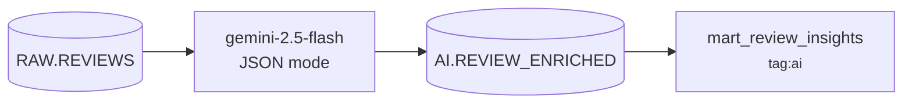
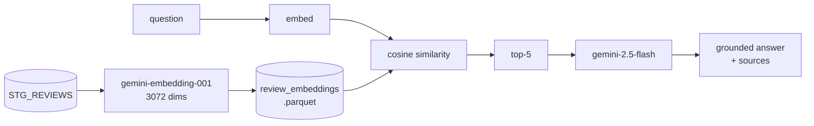
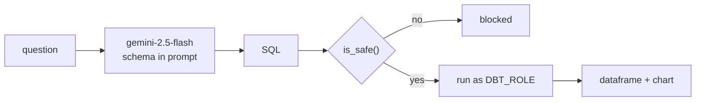

# The AI lane

Three capabilities, each solving a different problem, all on Google Gemini via
the `google-genai` SDK.

| # | Capability | Script | Model | Answers |
| - | ---------- | ------ | ----- | ------- |
| 1 | LLM enrichment | `ai/enrich_reviews.py` | `gemini-2.5-flash` | *What is this review about?* |
| 2 | RAG | `ai/rag_chat.py` | `gemini-embedding-001` + `gemini-2.5-flash` | *What do customers say about X?* |
| 3 | Text-to-SQL | `ai/text_to_sql.py` | `gemini-2.5-flash` | *What are the numbers?* |

---

## Contents

- [The fact that shapes all three](#the-fact-that-shapes-all-three)
- [1 · LLM enrichment](#1--llm-enrichment)
- [2 · RAG over reviews](#2--rag-over-reviews)
- [3 · Text-to-SQL](#3--text-to-sql)
- [The guard does not check correctness](#the-guard-does-not-check-correctness)
- [Migrating from OpenAI](#migrating-from-openai)
- [Quotas and limits](#quotas-and-limits)
- [Running them](#running-them)

---

## The fact that shapes all three

`reviews.comment` contains **294 distinct strings across 300,000 rows**.

Each string repeats roughly 1,020 times. That single measurement drives the
design of the whole lane:

| | Naïve | Exploiting the repetition |
| --- | --- | --- |
| Enrichment calls | 300,000 | **294** |
| Embedding vectors | 300,000 | **294** |
| Relative cost | 1,020× | **1×** |

For enrichment it is a cost argument. **For the vector store it is a quality
argument first**: embedding duplicates produces a store where
nearest-neighbour search returns a thousand copies of the same text and pushes
genuinely different reviews out of the top-k.

> Neither script currently does this. Both process rows rather than distinct
> comments. It is the highest-value improvement available in this lane.

---

## 1 · LLM enrichment

The model as a transform step. Not a chatbot — a function from free text to a
typed row.



**Extracts** `sentiment_label`, `sentiment_score` (−1.0 to 1.0), `topic` from a
fixed list, and `key_issue` (or null).

**Output is constrained** with `response_mime_type="application/json"` and
parsed straight into the insert. In testing, every response parsed on the first
try — no markdown fences, no preamble.

```text
"Far too expensive for what you get."
  -> {"sentiment_label": "negative", "sentiment_score": -0.8,
      "topic": "pricing", "key_issue": "too expensive"}

"It was okay, nothing special."
  -> {"sentiment_label": "neutral", "sentiment_score": 0.0,
      "topic": "other", "key_issue": null}
```

**Idempotent by construction.** The select excludes `review_id`s already
present in `REVIEW_ENRICHED`, so re-running enriches only what is new.

**Downstream**, `mart_review_insights` joins the enriched rows back to
`stg_reviews` at `(city, topic, sentiment_label)` grain. It carries
`{{ config(tags=['ai']) }}` so the Airflow DAG builds it *after* enrichment
rather than in the same pass as the rest of the graph.

---

## 2 · RAG over reviews

Answers grounded in retrieved reviews, with the sources shown.



**Retrieval ranks on meaning, not keywords.** Verified against the live
warehouse:

```text
Q: What are the most common complaints about delivery?

  0.722  (Hyderabad, 2*)  Delivery took over an hour.
  0.688  (Delhi, 1*)      Gravy spilled all over the bag. Delivery took over an hour.
  0.679  (Gurgaon, 2*)    Gravy spilled all over the bag. The rider got lost twice.
  0.674  (Allahabad, 2*)  The packaging leaked everywhere. The rider got lost twice.
  0.669  (Jaipur, 2*)     Portion was tiny for the price. Delivery took over an hour.

A: The most common complaints are that delivery took over an hour and that
   gravy spilled all over the bag/packaging leaked everywhere.
```

Every top match is a 1–2 star delivery complaint, and the answer stays inside
the retrieved set.

**Embeddings are chunked at 100** — Gemini rejects a larger batch outright.
**Vectors are cached to parquet**, so the embedding cost is paid once.

**`NEW_REVIEWS = 100`**, because `gemini-embedding-001` on the free tier allows
100 texts per minute. A 500-review corpus cannot complete a first load without
sleeping through four further quota windows.

The duplicate problem is visible in the run above — three of the top five share
*"Gravy spilled all over the bag"* or *"The rider got lost twice"* fragments.

---

## 3 · Text-to-SQL

Natural language to Snowflake SQL against the `MARTS` schema.



**Two independent controls**, because one is not enough:

1. `is_safe()` — must start with `SELECT` or `WITH`, and must contain none of
   `drop delete truncate alter update insert create replace grant revoke`
2. Execution as `DBT_ROLE`, which cannot escalate privileges or resize the
   warehouse

Verified: every mutation attempted was rejected.

```text
DROP TABLE FCT_ORDERS                   -> False
DELETE FROM FCT_ORDERS                  -> False
SELECT 1; DROP TABLE FCT_ORDERS         -> False
UPDATE FCT_ORDERS SET sales_amount = 0  -> False
```

And correct queries run:

```text
Q: Top 10 cities by GMV
   SELECT city, SUM(gmv) AS total_gmv FROM MART_DAILY_CITY_REVENUNE
   GROUP BY city ORDER BY total_gmv DESC LIMIT 10
   -> Bangalore 536,698,846 | Delhi 407,092,721
```

---

## The guard does not check correctness

This is the most important thing on this page.

The question *"Cancel rate by payment method"* produced SQL that **passed the
guard, ran cleanly, returned the right shape, and was wrong**:

```sql
COUNT(CASE WHEN order_status = 'Cancelled' THEN 1 ELSE 0 END) * 100.0 / COUNT(*)
```

`COUNT` counts non-`NULL` values, and `ELSE 0` is non-`NULL` — so the numerator
counts *every row*. The rate is `COUNT(*)/COUNT(*)`.

| payment_method | model wrote | correct |
| -------------- | ----------- | ------- |
| COD | **100.00%** | 5.98% |
| Card | **100.00%** | 6.02% |
| NetBanking | **100.00%** | 5.98% |
| UPI | **100.00%** | 5.99% |
| Wallet | **100.00%** | 5.98% |

`SUM(CASE ...)` — or `COUNT(CASE WHEN ... THEN 1 END)` with no `ELSE` — is
correct. The true rate is ~6%, matching the cancellation share in
[DATA_DICTIONARY.md](DATA_DICTIONARY.md).

**Nothing in the app catches this.** The result renders under a green
`5 rows returned`.

The lesson generalises: *a `SELECT`-only guard answers "can this query hurt the
warehouse?", never "is this answer right?"*. Those are different questions and
only one is being asked.

Worth noting: `MART_DAILY_CITY_REVENUNE` already computes `cancel_rate`
correctly, and the model used that same mart happily for the GMV question. It
hand-rolled a metric that was sitting there. A prompt rule — *if a `MART_` table
exposes the metric, use it; do not recompute from `FCT_`* — would likely have
avoided it.

---

## Migrating from OpenAI

The project began on OpenAI. Recorded here because the differences are not
mechanical.

| OpenAI | Gemini |
| ------ | ------ |
| `client.chat.completions.create` | `client.models.generate_content` |
| `messages=[{system}, {user}]` | `contents=…` + `config.system_instruction` |
| `response_format={"type": "json_object"}` | `config.response_mime_type="application/json"` |
| `response.choices[0].message.content` | `response.text` |
| `client.embeddings.create(input=…)` | `client.models.embed_content(contents=…)` |
| `response.data[].embedding` | `response.embeddings[].values` |
| `gpt-4o-mini` | `gemini-2.5-flash` |
| `text-embedding-3-small` (1536 dims) | `gemini-embedding-001` (3072 dims) |

**Use `google-genai`, not `google-generativeai`.** The latter is deprecated.

Three behavioural differences that are not renames:

1. **The system prompt is configuration, not a message.** There is no role
   plumbing — the user text is the whole of `contents`.
2. **`response.text` can be `None`.** Gemini returns no text when a response is
   blocked by a safety filter or produces no candidate, where OpenAI raised.
   `json.loads(None)` fails with a `TypeError` naming nothing useful, so all
   three scripts guard and surface `prompt_feedback` instead. The type checker
   catches this — the field is typed `str | None`.
3. **Embeddings cap at 100 texts per call.** OpenAI accepted the whole list;
   Gemini returns `400 INVALID_ARGUMENT`. `rag_chat.py` chunks.

---

## Quotas and limits

Measured against the free tier, not quoted from docs.

| Limit | Value | Consequence |
| ----- | ----- | ----------- |
| `embed_content` batch size | **100 texts per call** | hard `400` above it; chunking is mandatory |
| `embed_content` free tier | **100 texts per minute** | `NEW_REVIEWS` is 100, not 500 |
| SDK retry behaviour | automatic on 429 | retries consume quota, so a throttled run compounds |

The parquet cache means the embedding quota is a first-run concern only.

---

## Running them

All three read credentials from `ai/.env` — copy `ai/.env.example` and fill in.

```bash
cd ai

# 1 · enrichment (a script)
python enrich_reviews.py

# 2 · RAG chat (a Streamlit app)
streamlit run rag_chat.py

# 3 · text-to-SQL (a Streamlit app)
streamlit run text_to_sql.py
```

> **The Streamlit apps must be launched with `streamlit run`.** `python app.py`
> executes the file bare — no server, no session state — and emits a wall of
> `missing ScriptRunContext` warnings. Streamlit tells you the correct command
> in that output.

For local work, add `--server.address localhost`. Streamlit binds `0.0.0.0` by
default and prints an external URL, which on an untrusted network exposes an app
that queries your warehouse.
