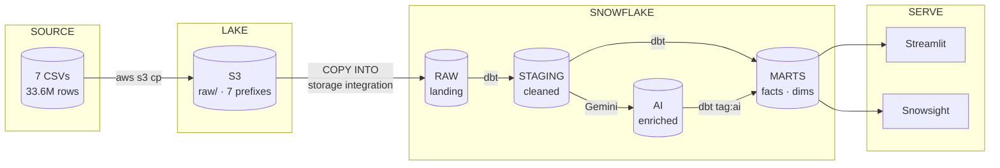
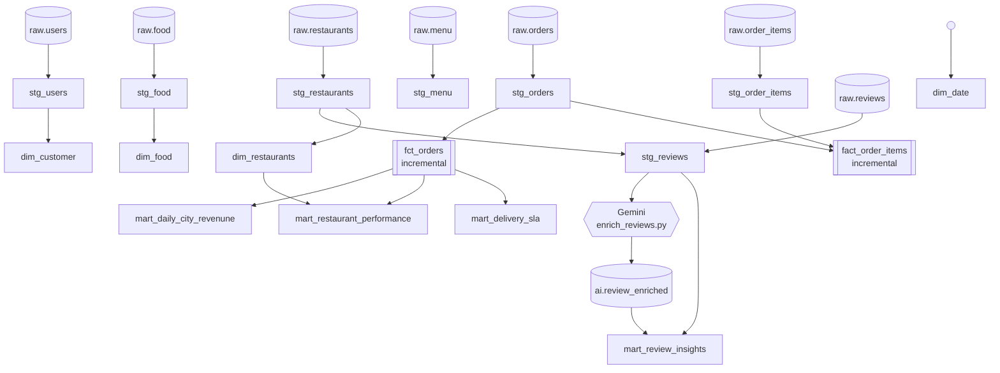
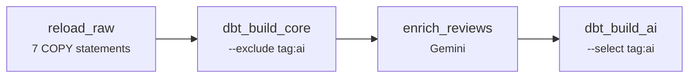
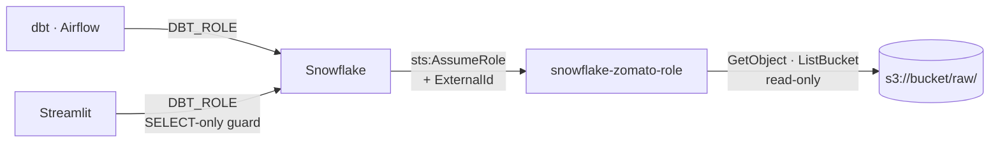

# Architecture

How the system is put together, and why each piece is shaped the way it is.

This is the design document. [RUNBOOK.md](RUNBOOK.md) is the operating manual,
[DATA_DICTIONARY.md](DATA_DICTIONARY.md) describes the data, [MODELS.md](MODELS.md)
is the model reference, and [AI_LANE.md](AI_LANE.md) covers the three AI
capabilities in depth.

---

## Contents

- [The shape of it](#the-shape-of-it)
- [Layer by layer](#layer-by-layer)
- [Lineage](#lineage)
- [Orchestration](#orchestration)
- [Five decisions worth defending](#five-decisions-worth-defending)
- [Security model](#security-model)
- [Cost model](#cost-model)
- [What this design does not do](#what-this-design-does-not-do)

---

## The shape of it

A medallion warehouse with an AI lane running **alongside** it rather than
bolted onto the end.



Seven source tables become four warehouse layers and three applications.
Nothing skips a layer.

---

## Layer by layer

### Source — 2.4 GB of CSVs

Seven files, mixed provenance, and the mix drives everything downstream:

| Shape | Tables | Character | Load policy |
| ----- | ------ | --------- | ----------- |
| **Generated facts** | `orders`, `order_items`, `reviews` | Clean, typed, internally consistent | `ON_ERROR = ABORT_STATEMENT` |
| **Scraped dimensions** | `restaurant`, `users`, `food`, `menu` | Sentinels, currency symbols, one ragged row | `ON_ERROR = CONTINUE` |

Two files exceed GitHub's 100 MB limit and live only in S3. The repo carries
`data/samples/` — the first 5,000 orders plus *every* line item belonging to
them, so the pair still joins. See [DATA_DICTIONARY.md](DATA_DICTIONARY.md).

### Lake — S3

One bucket, one prefix per table, so `COPY INTO @stage/orders/` expands
without scanning the other six.

Snowflake reads it by **assuming an IAM role via STS**. No AWS credential is
ever stored in Snowflake. See [Security model](#security-model).

### Bronze — `RAW`

The landing zone. Its job is to hold what S3 holds, faithfully, and to be
impossible to fail.

- **Dimensions land as all-`STRING`.** `restaurant.rating` holds `'--'` in
  87,014 of 148,541 rows; `cost` holds `'₹ 200'`; `lic_no` has leading zeros.
  Typing any of them here fails the load outright.
- **Facts land typed** — `NUMBER`, `DATE`, `TIMESTAMP_NTZ` — because they are
  generated and clean.
- **Column order is the contract.** `COPY INTO` without a transform loads by
  position. The four dimension files carry a leading pandas index column that
  the fact files do not, landed as `_idx` and dropped in staging.

### Silver — `STAGING`

Views. Cleaning, casting, renaming — thin work, so there is nothing to
materialise.

`TRY_*` where RAW landed a `STRING`, plain casts where RAW already typed it.
The asymmetry mirrors the `ON_ERROR` split one layer up.

### Gold — `MARTS`

Tables and incremental facts. Four conformed dimensions, two facts, four
aggregate marts. See [MODELS.md](MODELS.md).

### AI — `AI`

`REVIEW_ENRICHED`, written by `ai/enrich_reviews.py` outside dbt and read back
in as a declared source. That keeps it in the lineage graph rather than
appearing from nowhere.

---

## Lineage



The AI branch is the only path that leaves the warehouse and comes back. It is
declared as a source so dbt knows the dependency exists.

---

## Orchestration

One daily DAG, four tasks:



**Why the build is split in two.** `mart_review_insights` reads
`AI.REVIEW_ENRICHED`, which does not exist until `enrich_reviews` has run. A
single `dbt build` would compute it against stale rows. The `tag:ai` selector
splits the graph at exactly that seam.

Airflow 3 specifics that matter, all handled in `airflow/docker-compose.yaml`:

- `webserver` is now `api-server`
- DAG parsing is its own `dag-processor` component
- tasks reach the Execution API by **service name**, not localhost —
  without `AIRFLOW__CORE__EXECUTION_API_SERVER_URL` they die with a state
  mismatch that reads like a scheduler bug

dbt runs from `/opt/airflow/dbt_venv/bin/dbt`, its own virtualenv. Airflow
pins protobuf below 5 through OpenTelemetry; dbt-core 1.12 requires 6. No pair
of versions satisfies both, so they cannot share an environment. The local
development setup mirrors this with `.venv` and `.venv-airflow`.

---

## Five decisions worth defending

### 1 · A landing zone should be maximally tolerant; a transformation layer maximally strict

Failing at `RAW` means no data at all and nothing to inspect. Failing at
`STAGING` means the bad row is sitting in a table you can query.

Concretely: `food.csv` has **one** ragged row out of 371,561.
`ERROR_ON_COLUMN_COUNT_MISMATCH = FALSE` lets it NULL-fill and load; a
`not_null` test in staging catches it in daylight instead of aborting a
371,560-row load at 3 a.m.

### 2 · Stateful objects use `IF NOT EXISTS`; stateless use `CREATE OR REPLACE`

`CREATE OR REPLACE ROLE DBT_ROLE` succeeds, reports success, and silently
drops every grant on the role — including the `FUTURE` grants dbt needs to see
models it just created. The damage surfaces much later, somewhere unrelated.

Stages and file formats are pointers. Replacing them costs nothing.

### 3 · Facts are incremental, marts are tables, staging is views

Materialisation is the biggest lever on `dbt build` cost here.

| Layer | Materialisation | Why |
| ----- | --------------- | --- |
| staging | `view` | Thin casting work. `table` would rewrite 33.6 M rows per run to apply a `TRY_CAST`. |
| facts | `incremental` + `merge` | A full refresh of `fact_order_items` joins 23 M line items to 10 M orders. |
| marts | `table` | Read repeatedly by dashboards and text-to-SQL. Pay once. |

`merge` on a unique key rather than delete+insert makes reruns idempotent.

### 4 · Enrich the distinct set, not the table

`reviews.comment` holds **294 distinct strings across 300,000 rows**.

| Approach | Model calls | Relative cost |
| -------- | ----------- | ------------- |
| Row by row | 300,000 | 1,020× |
| Distinct, then join | 294 | **1×** |

For the vector store this is a *quality* problem before a cost one: embedding
duplicates means nearest-neighbour search returns a thousand copies of the
same text and crowds genuinely different reviews out of the results.

### 5 · The revenue guard belongs in every mart

Cancelled and refunded orders keep a populated `sales_amount` — nothing in the
source zeroes them. Roughly 8.5% of orders.

```sql
sum(iff(is_delivered, sales_amount, 0))   -- correct
sum(sales_amount)                          -- overstates by ~8.5%, looks fine
```

`stg_orders` exposes `is_delivered` rather than filtering, so the decision is
visible in each mart's SQL instead of hidden one layer down — and so
cancellation rate stays answerable.

---

## Security model



**No AWS credential is stored in Snowflake.** It assumes a role via STS and
receives short-lived credentials — there is no long-lived key to leak, rotate
or find in a screenshot.

**The external ID is the whole point.** Snowflake does not create a dedicated
AWS principal per customer; accounts on the same deployment share an IAM user,
so `STORAGE_AWS_IAM_USER_ARN` is neither secret nor unique. Without the
`sts:ExternalId` condition, any Snowflake customer on that deployment could
point their integration at your role ARN and have Snowflake — acting in good
faith — read your bucket. That is the
[confused-deputy problem](https://docs.aws.amazon.com/IAM/latest/UserGuide/confused-deputy.html).

Other deliberate choices:

- **Read-only on the bucket.** No `Put`, no `Delete`. S3 holds the only copy of
  `orders.csv` that is not in git.
- **`DBT_ROLE`, never `ACCOUNTADMIN`,** for every recurring job. Only the
  one-time provisioning scripts need it, and they say so on line 3.
- **`USAGE` + `OPERATE` on the warehouse, not ownership** — a scheduled job can
  run and resume it, but cannot resize it.
- **Generated SQL runs `SELECT`-only** behind a statement guard.

> **The guard is a security control, not a correctness one.** It asks whether a
> query can damage the warehouse, never whether the answer is right. See
> [AI_LANE.md](AI_LANE.md#the-guard-does-not-check-correctness) for a worked
> example where it passed a query reporting a 100% cancellation rate.

---

## Cost model

Built to run on a Snowflake trial and the AWS free tier.

| Item | Cost | Recurring? |
| ---- | ---- | ---------- |
| S3, 2.4 GB Standard | free tier, then ~$0.055/mo | yes |
| Initial `COPY`, 33.6 M rows | ≈0.25–0.7 credits | **one-time** |
| Daily `dbt build` | proportional to *new* data, not history | yes |
| Warehouse idle | **$0** — `AUTO_SUSPEND = 60` | — |
| Gemini enrichment, 294 distinct | free tier | per run |
| Embeddings, 100 reviews | free tier, cached to parquet | **one-time** |

The largest avoidable cost on a trial account is not a big query — it is a
warehouse left running overnight. `AUTO_SUSPEND = 60` and
`INITIALLY_SUSPENDED` exist for that.

`GEMINI_MAX_ROWS_PER_RUN` is a budget guard: a loop bug in the enrichment job
would otherwise spend a month's quota unattended.

---

## What this design does not do

Stated plainly, because a design document that only lists strengths is a
brochure.

- **No streaming.** Everything is batch. A Snowpipe definition sits commented
  out in `05_copy_into.sql` as the natural next step.
- **No late-arriving data handling.** Both incremental facts use a timestamp
  watermark, so a row whose `order_timestamp` predates the high-water mark is
  never picked up.
- **No dev/prod isolation.** `generate_schema_name` is overridden to use schema
  names verbatim, which is correct for one developer against pre-provisioned
  schemas and wrong the moment a second person builds against the same account.
- **No CI against a warehouse.** CI is deliberately credential-free; `dbt build`
  and `dbt test` belong in the Airflow run.
- **No RAG over the full corpus.** `NEW_REVIEWS = 100` fits the Gemini free
  tier's 100-texts-per-minute embedding quota.
- **No reconciliation tests.** Uniqueness catches duplicated rows; nothing
  catches *missing* ones, which is the failure mode the watermark boundary
  actually produces.
